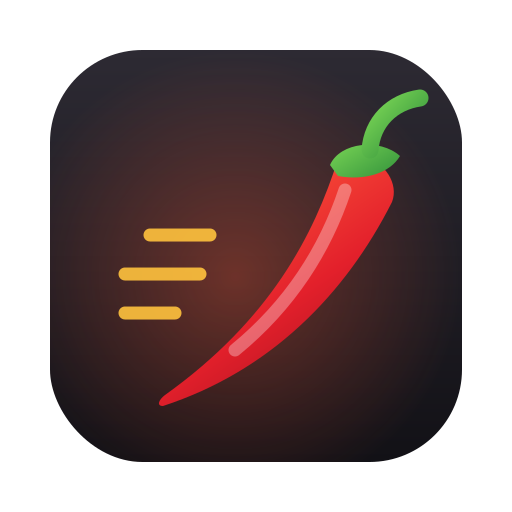

<div align="center">

  

  # Sili 🌶️
  *Run Windows games and apps on your Apple Silicon Mac, for free*

</div>

Sili is a free, open-source macOS app for running Windows software (including Steam and Steam games) on Apple Silicon Macs. It gives you a native SwiftUI interface for creating and managing "bottles" (separate Windows environments) on top of [Wine](https://www.winehq.org), with no Terminal work needed.

The name comes from *sili*, the chilli at the heart of Bicolano cooking. It's small, quick and a bit fiery.

> **Sili is a fork of [Whisky](https://github.com/Whisky-App/Whisky)** by Isaac Marovitz and contributors. Whisky stopped being maintained in 2025, and its engine download server has since gone offline, so new installs no longer work. Sili continues the project with a current Wine engine and new features. See [Credits](#credits--acknowledgments).

---

## What's different from Whisky

- **Working engine download.** The engine is now hosted on this repo's [`engine` release](https://github.com/xSeraphic/Sili/releases/tag/engine) instead of the offline `data.getwhisky.app` server.
- **Current Wine.** [Wine Staging 11.18](https://github.com/Gcenx/macOS_Wine_builds) replaces the 2022, CrossOver 22-based build.
- **DirectX 10/11 to Metal** through [DXMT](https://github.com/3Shain/dxmt).
- **Reproducible engine builds.** Run `scripts/build-engine.sh` to rebuild the engine from upstream releases.
- **New name, icon and bundle ID** (`com.mayonstudios.sili`), so Sili doesn't clash with an existing Whisky install.

## System requirements

- Apple Silicon Mac (M1 or later)
- macOS Sonoma 14.0 or later
- Rosetta 2 (`softwareupdate --install-rosetta`)

## Building from source

1. Install Xcode and SwiftLint: `brew install swiftlint`
2. Clone the repo, then build:

   ```sh
   git clone https://github.com/xSeraphic/Sili.git
   cd Sili
   xcodebuild -project Whisky.xcodeproj -scheme Whisky -configuration Release \
     -derivedDataPath ../Sili-build \
     CODE_SIGN_IDENTITY=- CODE_SIGN_STYLE=Manual DEVELOPMENT_TEAM= build
   ```

3. The app is at `../Sili-build/Build/Products/Release/Sili.app`.

Keep `-derivedDataPath` outside the repo, otherwise SwiftLint will try to lint the build output. Internal module and target names (`WhiskyKit`, `WhiskyCmd`, the `Whisky` scheme) are kept from upstream for now.

### Rebuilding the Wine engine

```sh
scripts/build-engine.sh 11.18 v0.80 3.0.0      # wine version, DXMT version, engine version
gh release upload engine dist/Libraries.tar.gz dist/WhiskyWineVersion.plist --clobber
```

Raising the engine version makes existing installs offer the update.

## Game compatibility

Not every game works. Games with kernel-level anti-cheat (Vanguard, some Easy Anti-Cheat and BattlEye setups) won't run under Wine on any Mac. Before trying a game, check [AppleGamingWiki](https://www.applegamingwiki.com) or the [CodeWeavers compatibility database](https://www.codeweavers.com/compatibility). Ratings for CrossOver are a good guide, because Sili is built on the same underlying technology.

---

## Credits & Acknowledgments

Sili is built on the work of these projects and people:

- **[Whisky](https://github.com/Whisky-App/Whisky)** by [Isaac Marovitz](https://github.com/IsaacMarovitz) and [all Whisky contributors](https://github.com/Whisky-App/Whisky/graphs/contributors). The app, its UI, WhiskyKit and WhiskyCmd all come from Whisky. Copyright notices in the source files are kept as required by the GPL.
- **[Wine](https://www.winehq.org)**, the compatibility layer that makes any of this possible.
- **[macOS Wine builds](https://github.com/Gcenx/macOS_Wine_builds)** by Gcenx, which provide the Wine Staging engine.
- **[DXMT](https://github.com/3Shain/dxmt)** by 3Shain, which translates DirectX 10/11 to Metal.
- **[DXVK-macOS](https://github.com/Gcenx/DXVK-macOS)** by Gcenx and doitsujin, and **[MoltenVK](https://github.com/KhronosGroup/MoltenVK)** by the Khronos Group, both used by Whisky.
- **[msync](https://github.com/marzent/wine-msync)** by marzent.
- **[Sparkle](https://github.com/sparkle-project/Sparkle)**, **[SemanticVersion](https://github.com/SwiftPackageIndex/SemanticVersion)**, **[swift-argument-parser](https://github.com/apple/swift-argument-parser)**, **[Progress.swift](https://github.com/jkandzi/Progress.swift)** and **[SwiftyTextTable](https://github.com/scottrhoyt/SwiftyTextTable)**.
- Whisky's translations were contributed through [Crowdin](https://crowdin.com/project/whisky).

Sili is not affiliated with or endorsed by the Whisky project, WineHQ or CodeWeavers.

## License

Sili is free software, released under the **[GNU General Public License v3.0](LICENSE)**, the same licence as Whisky. You can use, change and share it under the same terms. Any modified versions must also be open source under the GPLv3.

Bundled engine components (Wine, DXMT) are distributed under their own licences. See their repositories for details.

Maintained by [xSeraphic](https://github.com/xSeraphic) · Mayon Studios
